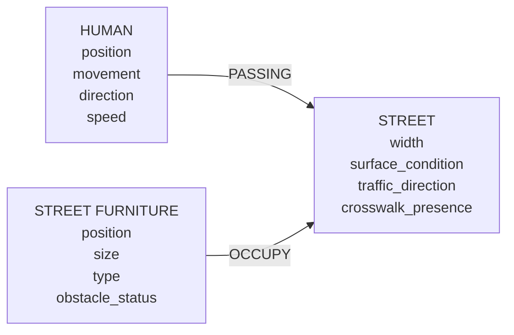

# Neighborhood — semantic model

The simulation is in `js/world.js`, which does no rendering. `js/main.js` draws it with three.js and wires up the toolbar.

## How the model maps to the app

| Model | In the app |
| --- | --- |
| **HUMAN**.position | `(x, z)` in meters, always on a traversable cell |
| **HUMAN**.movement | `moving`, `avoiding`, `rerouting`, `waiting`, `turning`, `stopped` or `arrived` (the colored ring at the feet) |
| **HUMAN**.direction | Heading angle (the white nose cone) |
| **HUMAN**.speed | Current m/s, which moves toward a preferred speed scaled by surface and context |
| **STREET**.width | Carriageway width (5–14 m). It sets the lane layout and how far a human has to cross |
| **STREET**.surface_condition | `good`, `wet`, `icy` or `damaged`. It scales walking speed (×1, ×0.8, ×0.45, ×0.65) and car speed, and affects route cost |
| **STREET**.traffic_direction | `two-way`, `one-way +` or `one-way −`. It sets the lanes, arrows and car flow, and which traffic a human checks before crossing |
| **STREET**.crosswalk_presence | Zebra crossings at the intersection plus a mid-block crossing. They are the only places a human can cross |
| **STREET_FURNITURE**.position | Stored relative to its street: side, distance along it, and offset from the curb |
| **STREET_FURNITURE**.size | S, M or L, scaling the type's footprint |
| **STREET_FURNITURE**.type | Bench, lamp post, trash bin, planter, street tree, bollard, fire hydrant, bus shelter, work barrier, manhole cover or drain grate |
| **STREET_FURNITURE**.obstacle_status | `true` blocks the footprint plus the human's radius (red). `false` can be walked over (green) |
| HUMAN —PASSING→ STREET | The street whose sidewalk or crosswalk the human is on |
| STREET_FURNITURE —OCCUPY→ STREET | Each piece of furniture belongs to one street's sidewalk |

## Rules

1. **Stay on a traversable surface.** Sidewalks are traversable, and so are crosswalks where `crosswalk_presence = true`. The roadway, the intersection box and the building lots are not. The rule is checked on every step and when planning routes. When the world changes under a human, they step back onto the nearest traversable cell.
2. **Obstacles.** Furniture with `obstacle_status = true` is cut out of the traversable grid.
3. **Movement responds to the street:**
   - **Geometry:** routes follow the sidewalks and turn at corners.
   - **Surface condition:** sets walking speed and route cost.
   - **Traffic direction:** at the curb, a human waits while a vehicle approaches the crossing in that street's direction.
   - **Crosswalk presence:** humans can only cross there. Removing a street's crosswalks can make a destination unreachable.

Cars yield to humans on a crosswalk and stop at red signals.

## Actions

| Action | Automatic trigger | Manual (toolbar, on the selected human) |
| --- | --- | --- |
| MOVE | Resumes after waiting at a curb | Walk the route, or straight ahead if there is no route |
| TURN | Logged at corners of the route | Turn 90° left or right, then walk straight in the new direction |
| STOP | Yields to traffic, arrives at the goal, or reaches the edge of the traversable surface | Halt |
| AVOID | An obstacle blocks the route within 4.5 m (local detour), or another human is in the way (sidestep) | Detour around what is ahead |
| REROUTE | The route is blocked farther ahead, or the local detour failed (global A*) | Re-plan to the destination, or pick a new one |
